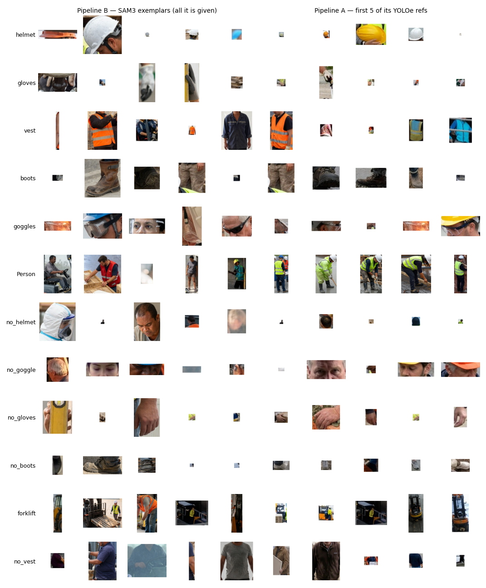
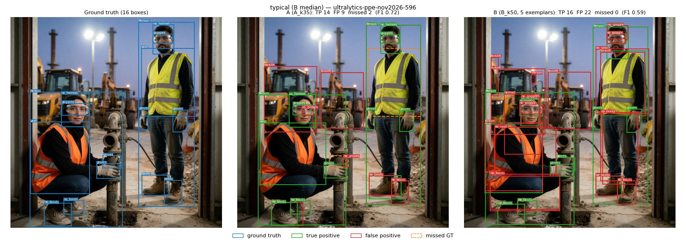
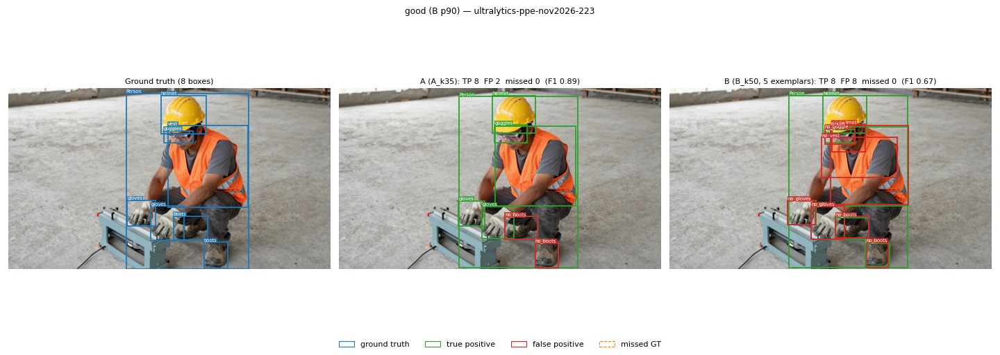
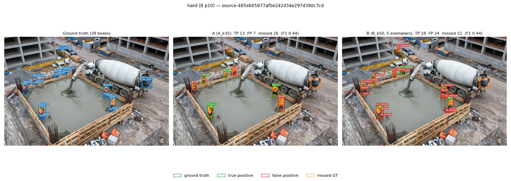
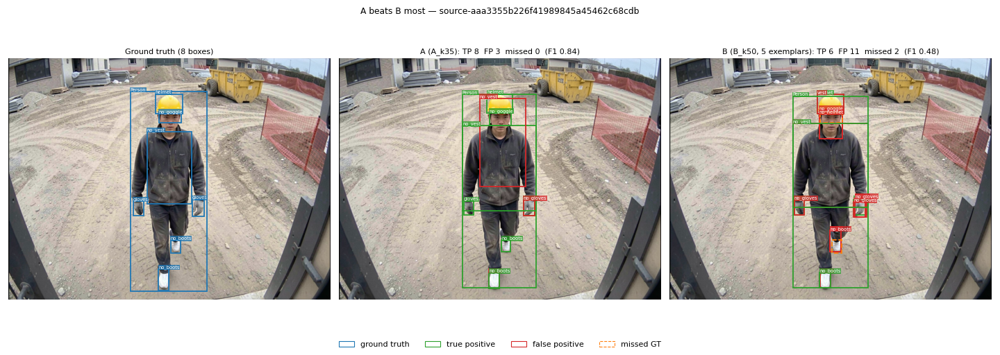

# Ablation study — Pipeline A (YOLOe) vs Pipeline B (SAM3)

Two ablations on the same data, split and hardware:

1. **SAM3 exemplar count** (Pipeline B): 3 / 5 / 10 exemplars per class, everything else fixed.
2. **k-shot sweep** (both pipelines): k ∈ {15, 20, …, 50} labelled references per class. Pipeline A uses all k as YOLOe visual prompts; Pipeline B uses k as its DINOv2 verification bank and keeps 5 SAM3 exemplars.

Raw evidence for every number below is in [docs/results/](results/) (per-run `metrics.json`, `timing.json`, `eval.txt`, per-class tables, log digest).

---

## TL;DR

| Question | Answer | Evidence |
|---|---|---|
| Does B beat A? | **Yes on recall and mAP**: B at its smallest k beats A at its best k. A keeps higher precision and F1. | B k15 vs A k35: ΔmAP@.50 **+0.041**, Δrecall **+0.114**, Δprecision −0.220, ΔF1 −0.099 |
| Do more SAM3 exemplars help? | **Yes, monotonically** for recall and mAP; precision falls and time grows ~linearly. | 3→5: ΔmAP +0.011, Δrecall +0.023; 5→10: ΔmAP +0.024, Δrecall +0.021 |
| Chosen exemplar count | **5** — balanced recall/precision at moderate cost. 10 is the best recall/mAP setting when time allows. | 5 → 10 costs 1.8× time and −0.080 precision for +0.021 recall |
| Best k | **A: k = 35** (mAP peaks, no gain after). **B: k = 30** by mAP, but **k = 15 is equivalent in practice** (+0.005, recall unchanged). | A k50 vs k35: ΔmAP −0.010; B k30 vs k15: Δrecall +0.000 |
| Why recall first | A missed object needs another detector or a manual search to recover; a false positive can be removed afterwards (stricter DINOv2 gate, stronger embedding model, EDA-based outlier review). | — |


---

## 1. Setup

| Item | Setting |
|---|---|
| Dataset | Construction-PPE, Ultralytics **2026-11-03 release** (the earlier 1,416-image release is no longer distributed; earlier numbers in [log.md](log.md) are not comparable) |
| Classes (12) | helmet, gloves, vest, boots, goggles, Person, forklift (**object classes**) · no_helmet, no_goggle, no_gloves, no_boots, no_vest (**absence classes**) |
| Labelled pool | official train split, 800 images, 11,902 labelled instances — all references come from here |
| Test set | official val split, 200 images, 2,961 GT boxes — never used as references |
| Metrics | AP@.50 (101-point), mAP@.5:.95 (COCO 10 IoUs); P/R/F1 at IoU 0.50 over **all** output boxes (no extra score threshold). "Micro" = pooled over all boxes; "macro" = mean over classes |
| Hardware | 1× RTX A4000 16 GB (vast.ai), one model in VRAM at a time |
| Thresholds | Defaults, fixed across all runs (see README §9 parameters) |
| Ref selection | Same pool + phash dedup (distance 4) for both. A: DBSCAN medoids + outliers ([extract_crops_labelled.py](../scripts/extract_crops_labelled.py)). B: farthest-point sampling (FPS) over DINOv2 CLS embeddings, most-diverse first; SAM3 exemplars = first N of that list |
| Batch sizes | YOLOe 16 targets; SAM3 16 canvases (`PYTORCH_CUDA_ALLOC_CONF=expandable_segments:True`); DINOv2 auto (~70% VRAM → 888–952) |
| Runs | 16 k-shot runs + 2 exemplar runs, **0 skipped batches, 0 warnings** in all 18 |

Reproduce: `bash experiments/run_kshot.sh` (k-shot), then the exemplar runs:

```bash
for E in 3 10; do O=runs/kshot/B_ex${E}_k50
  python scripts/sam3_dinov2_module.py --refs-dir data/label --refs-labels data/label --class-ids 0 1 2 3 4 5 6 7 8 9 10 11 \
    --targets-dir data/test --output-dir $O --dino-proto-size 50 --max-refs-per-class $E --phash-max-dist 4 --no-preview --batch-size 16
  python scripts/eval_map.py --preds $O/labels --gt data/test --images data/test --classes $(cat data/classes.txt) --out-json $O/metrics.json
done
```



*Left: the only SAM3 exemplars Pipeline B receives (first 5 of the FPS order). Right: first 5 of Pipeline A's 35 YOLOe references. FPS starts from the most atypical instance, so B's first exemplars include odd crops (a helmet edge strip, a tiny helmet, a vest sliver) — see §5.*

---

## 2. Experiment 1 — SAM3 exemplar count (Pipeline B, DINOv2 bank = 50)

Only `--max-refs-per-class` changes. The exemplar sets are nested (3 ⊂ 5 ⊂ 10) because they are prefixes of the same FPS order. The 5-exemplar run is `B_k50`.

### Overall

| Exemplars | mAP@.50 | mAP@.5:.95 | Precision | Recall | F1 (micro) | F1 (macro) | Object-class AP@.50 | Absence AP@.50 | nPred | Time / 200 img |
|---|---|---|---|---|---|---|---|---|---|---|
| 3 | 0.575 | 0.374 | **0.511** | 0.746 | **0.607** | **0.565** | 0.761 | 0.315 | 4,324 | **45 min** |
| **5** | 0.586 | 0.382 | 0.436 | 0.770 | 0.557 | 0.539 | 0.778 | 0.316 | 5,228 | 66 min |
| 10 | **0.610** | **0.402** | 0.356 | **0.791** | 0.491 | 0.471 | **0.807** | **0.334** | 6,585 | 121 min |

| Step | ΔmAP@.50 | ΔRecall | ΔPrecision | ΔF1 (micro) | ΔTime |
|---|---|---|---|---|---|
| 3 → 5 | +0.011 | +0.023 | −0.075 | −0.050 | +21 min (1.5×) |
| 5 → 10 | +0.024 | +0.021 | −0.080 | −0.066 | +55 min (1.8×) |

**Findings**
- **More exemplars → more recall and mAP, every step.** Each exemplar group is an independent SAM3 query, so more groups find more objects (union over groups + voting).
- **Recall gain per exemplar shrinks**: +0.012 per exemplar (3→5) vs +0.004 per exemplar (5→10). mAP gain per exemplar is roughly constant (~0.005).
- **Precision falls at the same rate as recall rises** (≈ −0.08 per step); F1 falls. From 3 to 10 exemplars, predictions grow 52% and false positives double (2,114 → 4,243) for +132 true positives.
- **Time is linear in exemplars** (SAM3 forward passes = groups × target batches): 45 → 66 → 121 min.

**Choice: 5 exemplars.** It keeps most of the recall (0.770 vs 0.791 at 10) at about half the time and with precision 0.436 vs 0.356. 10 exemplars is the best setting when maximum recall matters more than run time.

### Per class (AP@.50 / Recall / F1)

| Class | ex 3 | ex 5 | ex 10 | Note |
|---|---|---|---|---|
| helmet | 0.779 / 0.796 / 0.821 | 0.779 / 0.796 / 0.815 | 0.813 / 0.837 / 0.770 | gains only at 10 |
| gloves | 0.808 / 0.827 / 0.725 | 0.817 / 0.832 / 0.724 | 0.817 / 0.840 / 0.673 | saturated at 5 |
| vest | 0.612 / 0.738 / 0.706 | 0.704 / 0.826 / 0.681 | 0.851 / 0.906 / 0.702 | largest gain (+0.239 AP) |
| boots | 0.637 / 0.730 / 0.676 | 0.635 / 0.738 / 0.504 | 0.651 / 0.751 / 0.505 | +370 predictions from 3→5 |
| goggles | 0.906 / 0.928 / 0.902 | 0.920 / 0.935 / 0.903 | 0.914 / 0.935 / 0.524 | AP flat; predictions 149 → 357 at 10 |
| Person | 0.890 / 0.892 / 0.927 | 0.919 / 0.921 / 0.933 | 0.920 / 0.925 / 0.914 | saturated at 5 |
| forklift | 0.692 / 0.904 / 0.441 | 0.673 / 0.918 / 0.434 | 0.684 / 0.932 / 0.421 | high recall, ~3 predictions per GT |
| no_helmet | 0.343 / 0.514 / 0.281 | 0.404 / 0.603 / 0.306 | 0.432 / 0.615 / 0.234 | steady AP gain |
| no_goggle | 0.000 / 0.012 / 0.006 | 0.000 / 0.012 / 0.006 | 0.000 / 0.012 / 0.004 | **SAM3 never finds it** |
| no_gloves | 0.553 / 0.621 / 0.527 | 0.476 / 0.621 / 0.488 | 0.491 / 0.635 / 0.355 | best at 3 |
| no_boots | 0.323 / 0.781 / 0.381 | 0.330 / 0.787 / 0.287 | 0.351 / 0.792 / 0.251 |  |
| no_vest | 0.354 / 0.592 / 0.386 | 0.371 / 0.592 / 0.385 | 0.396 / 0.638 / 0.296 |  |

Full P / R / F1 / AP@.50 / AP@.5:.95 / nPred per class: [results/per_class_tables.md](results/per_class_tables.md) (`B_ex3_k50`, `B_k50`, `B_ex10_k50`).

---

## 3. Experiment 2 — k-shot sweep (A: k YOLOe refs; B: 5 SAM3 exemplars + DINOv2 bank of k)

### Overall

| k | A mAP@.50 | A mAP@.5:.95 | A P | A R | A F1 | A time | B mAP@.50 | B mAP@.5:.95 | B P | B R | B F1 | B time |
|---|---|---|---|---|---|---|---|---|---|---|---|---|
| 15 | 0.517 | 0.351 | **0.704** | 0.612 | 0.655 | **34 min** | 0.582 | 0.381 | 0.436 | 0.769 | 0.556 | 65 min |
| 20 | 0.527 | 0.355 | 0.696 | 0.629 | **0.661** | 43 | 0.585 | 0.382 | 0.436 | 0.769 | 0.556 | 65 |
| 25 | 0.529 | 0.354 | 0.684 | 0.640 | 0.661 | 50 | 0.586 | 0.382 | 0.436 | 0.769 | 0.556 | 65 |
| 30 | 0.535 | 0.357 | 0.667 | 0.644 | 0.656 | 56 | **0.587** | **0.383** | 0.435 | 0.769 | 0.556 | 66 |
| 35 | **0.542** | **0.358** | 0.656 | 0.655 | 0.655 | 63 | 0.587 | 0.382 | 0.436 | 0.769 | 0.556 | 66 |
| 40 | 0.532 | 0.352 | 0.620 | 0.662 | 0.640 | 70 | 0.587 | 0.383 | 0.436 | 0.769 | 0.556 | 66 |
| 45 | 0.531 | 0.349 | 0.590 | 0.666 | 0.626 | 75 | 0.587 | 0.383 | 0.436 | 0.769 | 0.556 | 66 |
| 50 | 0.532 | 0.350 | 0.582 | **0.672** | 0.624 | 80 | 0.586 | 0.382 | 0.436 | **0.770** | 0.557 | 66 |

P/R/F1 are micro (pooled over all boxes). Macro F1, object/absence AP and nPred for every run: [results/per_class_tables.md](results/per_class_tables.md).

### Key differences

| Comparison | ΔmAP@.50 | ΔRecall | ΔPrecision | ΔF1 (micro) |
|---|---|---|---|---|
| **B k15 − A k35** (B smallest k vs A best k) | **+0.041** | **+0.114** | −0.220 | −0.099 |
| B k15 − A k15 (same k) | +0.065 | +0.157 | −0.269 | −0.099 |
| B ex10 − A k35 (best B vs best A) | **+0.068** | **+0.136** | −0.300 | −0.165 |
| A k35 − A k15 | +0.025 | +0.043 | −0.049 | +0.000 |
| A k50 − A k35 | −0.010 | +0.017 | −0.074 | −0.032 |
| B k30 − B k15 | +0.005 | +0.000 | −0.000 | −0.000 |

### Pipeline A — scaling with k

- **mAP peaks at k = 35** (+0.025 over k = 15); k = 50 is not better than k = 35.
- **F1 does not improve with k**: k = 15 → 35 ΔF1 +0.000, k = 35 → 50 ΔF1 −0.032. More references trade precision for recall one-for-one.
- **Recall keeps rising** (0.612 → 0.672) but **precision falls faster** (0.704 → 0.582): every extra reference frame is another YOLOe query, adding proposals. Cross-reference dedup removes most duplicates (k = 35: 70,082 → 10,630 proposals, −85%) but new low-quality proposals still pass.
- **Cost is linear in k**: YOLOe re-runs over all targets per reference frame (34 → 80 min; YOLOe = 82–87% of run time).
- **Some classes degrade with more references**: vest AP 0.594 (k25) → 0.491 (k40); no_goggle 0.200 (k20) → 0.071 (k50); goggles F1 0.867 (k35) → 0.596 (k45) with AP unchanged (false-positive burst).

### Pipeline B — why the curve is flat

- **The 5 SAM3 exemplars are identical at every k.** FPS is greedy and deterministic over the same pool, so its first 5 picks never change (verified for all 12 classes from the logs, [results/run_log_facts.md](results/run_log_facts.md)). SAM3 therefore produces the same proposals at every k.
- **The DINOv2 bank only re-scores.** A larger bank raises best-match similarity (median 0.663 at k = 15 → 0.723 at k = 45), which reorders boxes: +0.005 mAP, recall unchanged.
- **The DINOv2 gate rejects nothing at the default threshold.** Lowest kept `0.2·sam3 + 0.8·dino_sim` = 0.271 (k = 15) / 0.275 (k = 45) against a 0.2 gate → nPred ≈ 5,228 at every k. B's output is effectively SAM3 + voting.
- **Practical reading:** B at k = 15 is as good as B at k = 30–50 — the smallest labelling budget is enough. The unused DINOv2 bank is the obvious lever for precision (§6).

### Per class — AP@.50 across k

**Pipeline A**

| Class | k=15 | k=20 | k=25 | k=30 | k=35 | k=40 | k=45 | k=50 |
|---|---|---|---|---|---|---|---|---|
| helmet | 0.742 | 0.762 | 0.771 | 0.771 | 0.771 | 0.771 | 0.781 | 0.781 |
| gloves | 0.603 | 0.614 | 0.623 | 0.633 | 0.643 | 0.653 | 0.662 | 0.662 |
| vest | 0.590 | 0.593 | 0.594 | 0.585 | 0.564 | 0.489 | 0.489 | 0.491 |
| boots | 0.497 | 0.494 | 0.508 | 0.502 | 0.523 | 0.531 | 0.528 | 0.536 |
| goggles | 0.910 | 0.919 | 0.914 | 0.914 | 0.914 | 0.922 | 0.900 | 0.912 |
| Person | 0.743 | 0.752 | 0.762 | 0.762 | 0.772 | 0.772 | 0.772 | 0.772 |
| forklift | 0.705 | 0.694 | 0.698 | 0.754 | 0.795 | 0.797 | 0.771 | 0.770 |
| no_helmet | 0.295 | 0.315 | 0.341 | 0.350 | 0.388 | 0.294 | 0.309 | 0.319 |
| no_goggle | 0.177 | 0.200 | 0.128 | 0.104 | 0.079 | 0.076 | 0.078 | 0.071 |
| no_gloves | 0.242 | 0.266 | 0.288 | 0.305 | 0.302 | 0.302 | 0.310 | 0.320 |
| no_boots | 0.456 | 0.456 | 0.466 | 0.478 | 0.481 | 0.482 | 0.486 | 0.487 |
| no_vest | 0.247 | 0.257 | 0.250 | 0.266 | 0.271 | 0.291 | 0.284 | 0.262 |

**Pipeline B**

| Class | k=15 | k=20 | k=25 | k=30 | k=35 | k=40 | k=45 | k=50 |
|---|---|---|---|---|---|---|---|---|
| helmet | 0.780 | 0.780 | 0.779 | 0.780 | 0.779 | 0.779 | 0.779 | 0.779 |
| gloves | 0.818 | 0.817 | 0.818 | 0.820 | 0.818 | 0.817 | 0.817 | 0.817 |
| vest | 0.697 | 0.702 | 0.705 | 0.703 | 0.704 | 0.705 | 0.705 | 0.704 |
| boots | 0.651 | 0.648 | 0.649 | 0.647 | 0.629 | 0.637 | 0.638 | 0.635 |
| goggles | 0.920 | 0.921 | 0.921 | 0.921 | 0.921 | 0.919 | 0.920 | 0.920 |
| Person | 0.919 | 0.919 | 0.919 | 0.919 | 0.919 | 0.919 | 0.919 | 0.919 |
| forklift | 0.656 | 0.646 | 0.650 | 0.659 | 0.666 | 0.671 | 0.672 | 0.673 |
| no_helmet | 0.397 | 0.400 | 0.413 | 0.419 | 0.418 | 0.416 | 0.417 | 0.404 |
| no_goggle | 0.000 | 0.000 | 0.000 | 0.000 | 0.000 | 0.000 | 0.000 | 0.000 |
| no_gloves | 0.462 | 0.486 | 0.486 | 0.484 | 0.487 | 0.481 | 0.479 | 0.476 |
| no_boots | 0.328 | 0.327 | 0.326 | 0.326 | 0.329 | 0.329 | 0.329 | 0.330 |
| no_vest | 0.363 | 0.368 | 0.368 | 0.370 | 0.372 | 0.371 | 0.370 | 0.371 |

### Per class — F1 across k

**Pipeline A**

| Class | k=15 | k=20 | k=25 | k=30 | k=35 | k=40 | k=45 | k=50 |
|---|---|---|---|---|---|---|---|---|
| helmet | 0.848 | 0.863 | 0.861 | 0.860 | 0.864 | 0.863 | 0.863 | 0.867 |
| gloves | 0.747 | 0.761 | 0.767 | 0.773 | 0.777 | 0.785 | 0.789 | 0.793 |
| vest | 0.674 | 0.672 | 0.673 | 0.660 | 0.658 | 0.636 | 0.634 | 0.633 |
| boots | 0.621 | 0.623 | 0.629 | 0.631 | 0.647 | 0.649 | 0.653 | 0.657 |
| goggles | 0.935 | 0.939 | 0.890 | 0.887 | 0.867 | 0.870 | 0.596 | 0.598 |
| Person | 0.853 | 0.862 | 0.870 | 0.870 | 0.871 | 0.875 | 0.875 | 0.875 |
| forklift | 0.521 | 0.514 | 0.518 | 0.521 | 0.523 | 0.525 | 0.504 | 0.500 |
| no_helmet | 0.457 | 0.471 | 0.488 | 0.481 | 0.505 | 0.381 | 0.396 | 0.401 |
| no_goggle | 0.267 | 0.287 | 0.262 | 0.208 | 0.186 | 0.179 | 0.177 | 0.171 |
| no_gloves | 0.456 | 0.479 | 0.501 | 0.519 | 0.515 | 0.512 | 0.513 | 0.528 |
| no_boots | 0.457 | 0.462 | 0.462 | 0.460 | 0.461 | 0.459 | 0.462 | 0.460 |
| no_vest | 0.430 | 0.438 | 0.443 | 0.441 | 0.442 | 0.445 | 0.437 | 0.381 |

**Pipeline B**

| Class | k=15 | k=20 | k=25 | k=30 | k=35 | k=40 | k=45 | k=50 |
|---|---|---|---|---|---|---|---|---|
| helmet | 0.815 | 0.815 | 0.815 | 0.815 | 0.815 | 0.815 | 0.815 | 0.815 |
| gloves | 0.724 | 0.724 | 0.724 | 0.723 | 0.724 | 0.724 | 0.724 | 0.724 |
| vest | 0.681 | 0.681 | 0.681 | 0.681 | 0.681 | 0.681 | 0.681 | 0.681 |
| boots | 0.506 | 0.506 | 0.506 | 0.504 | 0.504 | 0.504 | 0.504 | 0.504 |
| goggles | 0.900 | 0.906 | 0.903 | 0.903 | 0.903 | 0.903 | 0.903 | 0.903 |
| Person | 0.933 | 0.933 | 0.933 | 0.933 | 0.933 | 0.933 | 0.933 | 0.933 |
| forklift | 0.430 | 0.430 | 0.430 | 0.432 | 0.432 | 0.434 | 0.434 | 0.434 |
| no_helmet | 0.306 | 0.303 | 0.303 | 0.306 | 0.306 | 0.306 | 0.306 | 0.306 |
| no_goggle | 0.006 | 0.006 | 0.006 | 0.006 | 0.006 | 0.006 | 0.006 | 0.006 |
| no_gloves | 0.488 | 0.488 | 0.488 | 0.488 | 0.488 | 0.488 | 0.488 | 0.488 |
| no_boots | 0.285 | 0.285 | 0.285 | 0.285 | 0.285 | 0.285 | 0.285 | 0.287 |
| no_vest | 0.385 | 0.385 | 0.385 | 0.385 | 0.385 | 0.385 | 0.385 | 0.385 |

### Per class — operating points (A k = 35 vs B k = 15), P / R / F1 / AP@.50

| Class | A k35 | B k15 | Winner (AP@.50) |
|---|---|---|---|
| helmet | 0.970 / 0.779 / 0.864 / 0.771 | 0.836 / 0.796 / 0.815 / 0.780 | tie |
| gloves | 0.976 / 0.646 / 0.777 / 0.643 | 0.640 / 0.832 / 0.724 / 0.818 | **B** +0.175 |
| vest | 0.694 / 0.626 / 0.658 / 0.564 | 0.579 / 0.826 / 0.681 / 0.697 | **B** +0.133 |
| boots | 0.675 / 0.622 / 0.647 / 0.523 | 0.384 / 0.740 / 0.506 / 0.651 | **B** +0.128 |
| goggles | 0.807 / 0.935 / 0.867 / 0.914 | 0.867 / 0.935 / 0.900 / 0.920 | tie |
| Person | 1.000 / 0.771 / 0.871 / 0.772 | 0.945 / 0.921 / 0.933 / 0.919 | **B** +0.147 |
| forklift | 0.364 / 0.932 / 0.523 / 0.795 | 0.282 / 0.904 / 0.430 / 0.656 | **A** +0.139 |
| no_helmet | 0.611 / 0.430 / 0.505 / 0.388 | 0.205 / 0.603 / 0.306 / 0.397 | tie |
| no_goggle | 0.129 / 0.329 / 0.186 / 0.079 | 0.004 / 0.012 / 0.006 / 0.000 | **A** |
| no_gloves | 0.557 / 0.478 / 0.515 / 0.302 | 0.403 / 0.621 / 0.488 / 0.462 | **B** +0.160 |
| no_boots | 0.334 / 0.742 / 0.461 / 0.481 | 0.174 / 0.781 / 0.285 / 0.328 | **A** +0.153 |
| no_vest | 0.521 / 0.385 / 0.442 / 0.271 | 0.285 / 0.592 / 0.385 / 0.363 | **B** +0.092 |

B wins 6 classes, A wins 3, 3 ties. **B's recall is ≥ A's on 10 of 12 classes** (exceptions: forklift 0.904 vs 0.932, no_goggle 0.012 vs 0.329).

---

## 4. Head-to-head and qualitative examples

**Where B wins:** recall (+0.11 to +0.16 absolute), mAP@.50 (+0.04 to +0.07), mAP@.5:.95 (+0.02 to +0.03), and the person-attached object classes (Person, gloves, vest, boots) by large margins — with 5 exemplars against A's 15–50 references.

**Where A wins:** precision (0.58–0.70 vs 0.44) and therefore F1 (micro 0.655 vs 0.556); per-image F1 is higher for A on 162 of 200 images (mean 0.668 vs 0.568). A also wins forklift, no_boots and no_goggle, and is ~2× faster at k = 15.

**Interpretation.** At the default operating point, B produces 1.8 boxes per GT (5,228 / 2,961) versus 1.0 for A. For auto-annotation, recall is the binding constraint — false positives are cheaper to remove than missed objects are to find — so B is the stronger proposal stage. Its precision gap is a post-processing problem with untouched levers (§6), not a property of SAM3 proposals.

Examples below are **not hand-picked**: chosen by Pipeline B's per-image F1 (90th percentile, median, 10th percentile) plus the image where A beats B by the widest margin ([experiments/make_figures.py](../experiments/make_figures.py)). Green = TP, red = FP, dashed orange = missed GT (IoU 0.50). A = `A_k35`, B = `B_k50` (5 exemplars).






---

## 5. Threats to validity

- **One dataset, one split, one run per setting.**
- **Thresholds were calibrated on the previous dataset release** and not re-tuned; B's gate in particular is mis-calibrated for this release.
- **References are selected from the full labelled pool** (11,902 instances), for both pipelines. In practice a user labels ~k instances; selecting the most diverse k (or 5) from thousands is an optimistic setting. B's exemplars are additionally the *most atypical* instances (FPS seed = farthest from the mean), which may under-represent B.
- **Size routing differs between pipelines and between k.** The p90-area rule is evaluated on each pipeline's own references, so the no-mask class set differs (A k35: {no_helmet}; B k15: {gloves, goggles, no_helmet, no_goggle, no_gloves}; B k45: {helmet, gloves, goggles, no_helmet, no_gloves}). Several classes sit just above the 0.01 cut-off (p90 0.011–0.019).
- **Ground truth was not audited.** Absence classes (`no_*`) are defined by a missing item and are the most likely to carry labelling inconsistency; read their numbers as indicative.
- **AP ranks by each pipeline's own score** (A: fused WBF score; B: voted final score), so AP also reflects score calibration, not only box quality.

---

## 6. Implications and next experiments

1. **Use B's unused DINOv2 bank as the FP filter.** Sweep `--sam3-dino-thresh` (or gate on `dino_sim` alone) — tune on a held-out part of the labelled pool, not on the test split. Expected: precision up with small recall cost.
2. **Stronger verification embedding** (e.g. a VLM such as Qwen-VL) where VRAM allows — out of budget on 8 GB.
3. **EDA-based FP review**: embedding outliers / cluster review of B's output before human QA.
4. **Exemplar selection**: typical (medoid / cluster-centre) exemplars instead of FPS-first outliers; and exemplars drawn from only k labelled instances to test the realistic few-shot setting.
5. **Hybrid per class**: B for object classes; A for forklift, no_boots, no_goggle.
6. **Absence classes**: SAM3 negative exemplars, or derive `no_X` from `Person` boxes without an overlapping `X`.
7. **Pin size routing** (`--no-mask-classes`) to remove the routing confound across k and pipelines.

---

## 7. Evidence index

| File | Content |
|---|---|
| [results/runs/&lt;run&gt;/metrics.json](results/runs/) | Per-run overall + per-class P/R/F1/AP@.50/AP@.5:.95/nPred/nGT |
| [results/runs/&lt;run&gt;/timing.json](results/runs/) | Per-phase wall-clock, `skipped_batches` |
| [results/runs/&lt;run&gt;/eval.txt](results/runs/) | Full evaluator output incl. per-image TP/FP/FN per class |
| [results/per_class_tables.md](results/per_class_tables.md) | Per-class tables for all 18 runs |
| [results/kshot_summary.md](results/kshot_summary.md) | `summarize_kshot.py` output (mAP vs k, per-phase time, per-class AP@.50) |
| [results/run_log_facts.md](results/run_log_facts.md) | Log digest: reference counts, size routing, proposal dedup, gate pass counts, SAM3 exemplars, ref-mask failures, auto batch size |

Run names: `A_k<k>` = Pipeline A with k references; `B_k<k>` = Pipeline B, 5 exemplars, DINOv2 bank k; `B_ex<E>_k50` = Pipeline B, E exemplars, bank 50. Observed resources: SAM3 ~11 GB VRAM at batch 16, YOLOe ~3 GB, GPU ≤ 85 °C; GPU telemetry log not retained.
